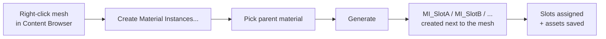

# Material Instance Tool

**One right-click turns every material slot of a mesh into its own named Material Instance — created next to the asset and assigned back automatically.**

[中文说明](README.zh-CN.md) · Unreal Engine 5.x · Editor-only · MIT License


---

## The problem

Import a character (MMD, CC, VRM, a sculpt, a marketplace pack…) and you get one mesh with a dozen material slots, all pointing at the same shared master material. To give a single slot its own roughness, texture or color you have to:

1. Right-click the master material → **Create Material Instance**
2. Name it `MI_Face`, repeat 20 times
3. Open the mesh → assign each instance to its slot

That is ~60 manual steps per character, and the Material Instance assets end up scattered wherever you happened to be browsing.

## What this tool does

Right-click the mesh → **Create Material Instances...** → pick the parent material → **Generate**.

- One `Material Instance Constant` per slot, named `MI_<SlotName>`
- Created **in the mesh's own folder** (never a separate dump folder)
- Assigned back to the mesh and saved automatically
- Safe to re-run: existing instances are reused, or deleted and rebuilt if you tick **Overwrite Existing**



### Before / after

```
/Game/Characters/Leimi/
├── Leimi_Swimsuit.uasset     ← slots point at one shared material
└── M_Leimi.uasset
```

```
/Game/Characters/Leimi/
├── Leimi_Swimsuit.uasset     ← slots now point at their own instances
├── M_Leimi.uasset
├── MI_Body.uasset
├── MI_Face.uasset
├── MI_Hair.uasset
└── MI_Swimsuit.uasset
```

## Features

| Feature | Details |
|---|---|
| Static Mesh + Skeletal Mesh | Both asset types are supported |
| One click from the Content Browser | Right-click entry, the panel opens with the mesh already loaded |
| Folder follows the mesh | Output folder is derived from the mesh path and shown read-only — instances can't be misplaced |
| Slot-name based naming | `MI_` prefix is configurable; illegal characters (`/ \ : * ? " < > \| .` spaces, tabs) are replaced with `_` |
| Idempotent | Existing instances are reused; **Overwrite Existing** deletes and rebuilds them |
| Auto-assign + save | Material slots are written back and both mesh and instances are saved |
| Cheap right-click | The mesh is only loaded when you actually click the menu entry |
| Editor-only | Module type is `Editor` — it never ships in a packaged build |

## Installation

### Option A — prebuilt binaries (no compiler)

1. Download `MaterialInstanceTool_Binaries_Win64_UE5.8_vX.zip` from [Releases](../../releases).
2. Extract the `MaterialInstanceTool` folder into `<YourProject>/Plugins/`.
3. Launch the project. If the editor asks to rebuild modules, answer **Yes**.

> The prebuilt archive is marked `"Installed": true`, so UnrealBuildTool treats it as a precompiled plugin. Windows x64 and **UE 5.8** only.

### Option B — from source (recommended, any 5.x)

```bash
cd <YourProject>/Plugins
git clone https://github.com/lhcx-e/MaterialInstanceCreateandAttachtoMeshTool.git MaterialInstanceTool
```

Restart the editor and answer **Yes** to the rebuild prompt, or build explicitly:

```bash
"<UE_ROOT>/Engine/Build/BatchFiles/Build.bat" <ProjectName>Editor Win64 Development ^
  -Project="<Absolute/Path/To/Project.uproject>" -WaitMutex
```

Requires Visual Studio 2022 with the *Game development with C++* workload.

### Option C — available in every project on this machine

Copy the plugin folder to:

```
<UE_ROOT>/Engine/Plugins/Marketplace/MaterialInstanceTool/
```

All projects using that engine build can now enable it. Engine upgrades will not carry it over — reinstall after switching engine versions.

## Usage

### From the Content Browser

1. Right-click a Static Mesh or Skeletal Mesh asset.
2. Choose **Create Material Instances...**
3. Pick the **Parent Material** (e.g. your master material).
4. Adjust the prefix / overwrite checkbox if needed.
5. Press **Generate Material Instances**.

The log at the bottom of the panel reports every created and reused instance.

### From the menu bar

**Tools → Material Instance Tool**, or the toolbar button of the same name. Then pick the mesh inside the panel.

### Options

| Field | Description |
|---|---|
| Target Mesh | Static or Skeletal Mesh. Pre-filled when opened from the Content Browser |
| Parent Material | The material every generated instance inherits from |
| Output Folder | **Read-only** — always the folder of the target mesh |
| Instance Name Prefix | Default `MI_`. Final name = prefix + sanitized slot name |
| Overwrite Existing | Off: reuse an existing asset with the same name. On: delete and recreate it |

## How it works

- `UMaterialInstanceConstantFactoryNew` with `InitialParent` creates the assets through `IAssetTools::CreateAsset`.
- The output folder comes from `FPackageName::GetLongPackagePath(Mesh->GetPathName())`.
- Slot assignment uses `FSkeletalMaterial::MaterialInterface` (written back with `USkeletalMesh::SetMaterials`) and `UStaticMesh::SetMaterial`.
- Everything is persisted with `UEditorAssetLibrary::SaveLoadedAssets`.
- No parameters are created or modified — the tool only gives each slot its own instance. Tune parameters per instance afterwards.

## Compatibility

| Engine | Status |
|---|---|
| UE 5.8 | Tested (binaries provided) |
| UE 5.4 – 5.7 | Expected to work when compiled from source |
| UE 4.x | Not supported |

If your engine differs from the prebuilt binary version, use Option B (source).

## FAQ

**The right-click entry does not appear.**
Make sure the plugin is enabled in *Edit → Plugins* and restart the editor. The entry is only added for Static Mesh and Skeletal Mesh assets.

**The editor says modules are missing or outdated.**
Answer **Yes** to rebuild. This is normal for C++ plugins after an engine upgrade.

**Instances were reused but I changed the parent material.**
Tick **Overwrite Existing** — reuse deliberately keeps the existing asset untouched.

**Two meshes in the same folder share slot names.**
Their instances would collide by design. Change the prefix (e.g. `MI_Body_`) or move the meshes apart.

**Can I select several meshes at once?**
Not yet — the panel works on one mesh at a time (the first mesh in a multi-selection is used).

**Does it work in a packaged game?**
No, it is an editor module. Nothing is included in a shipping build.

## Building from source (contributors)

The plugin has no external dependencies beyond the engine:

```
Source/MaterialInstanceTool/       Module + menus + Slate panel
  MaterialInstanceGenerator.*      Core asset creation logic
  SMaterialInstanceToolWidget.*    The Slate UI
  MaterialInstanceToolStyle.*      Icon/style set
```

See [CHANGELOG.md](CHANGELOG.md) for what changed between versions.

## Author

Made by **浪花春雪** ([@lhcx-e](https://github.com/lhcx-e)) — issues and pull requests are welcome.

## License

[MIT](LICENSE) © 2026 lhcx — use it, ship it, fork it. Not affiliated with or endorsed by Epic Games.
