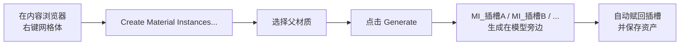

# Material Instance Tool（材质实例批量生成工具）

**右键点一下，就能把网格体的每个材质插槽都变成独立命名的材质实例——生成在模型旁边的文件夹里，并自动赋回网格体。**

[English](README.md) · Unreal Engine 5.x · 纯编辑器插件 · MIT 协议


---

## 它解决什么问题

导入一个角色（MMD、CC、VRM、雕刻模型、商城资源……）之后，你得到的是一个网格体加十几个材质插槽，全部指向同一个共享母材质。想让某一个插槽单独改粗糙度、贴图或颜色，你得：

1. 右键母材质 → **Create Material Instance**
2. 命名为 `MI_Face`，然后重复 20 次
3. 打开网格体 → 把每个实例挨个拖进对应插槽

一个角色差不多 60 步机械操作，而且生成出来的实例资产会散落在你当时浏览的任意目录里。

## 这个工具做什么

右键网格体 → **Create Material Instances...** → 选父材质 → **Generate**。

- 每个插槽生成一个 `Material Instance Constant`，命名为 `MI_<插槽名>`
- **直接创建在网格体自己所在的文件夹**（不会丢到别的地方）
- 自动赋回网格体的材质插槽并保存
- 可以反复运行：已存在的实例会被复用；勾选 **Overwrite Existing** 则删除重建



### 前后对比

```
/Game/Characters/Leimi/
├── Leimi_Swimsuit.uasset     ← 所有插槽都指向同一个共享材质
└── M_Leimi.uasset
```

```
/Game/Characters/Leimi/
├── Leimi_Swimsuit.uasset     ← 每个插槽指向自己的实例
├── M_Leimi.uasset
├── MI_Body.uasset
├── MI_Face.uasset
├── MI_Hair.uasset
└── MI_Swimsuit.uasset
```

## 功能

| 功能 | 说明 |
|---|---|
| 骨骼网格体 + 静态网格体 | 两种资产都支持 |
| 右键一步直达 | 面板自动打开并带入该网格体，插槽列表已列好 |
| 输出目录跟随网格体 | 由网格体路径推导，只读显示，永远不会放错位置 |
| 按插槽名命名 | 前缀 `MI_` 可改；非法字符（`/ \ : * ? " < > \| .` 空格、制表符）自动替换为 `_` |
| 幂等 | 已存在则复用；勾选 **Overwrite Existing** 则删除重建 |
| 自动赋值 + 保存 | 写回材质插槽，同时保存网格体和实例 |
| 右键零开销 | 只有真正点击菜单项时才加载网格体资产 |
| 纯编辑器 | 模块类型为 `Editor`，不会进入打包后的游戏 |

## 安装

### 方式一：预编译版本（无需编译器）

1. 从 [Releases](../../releases) 下载 `MaterialInstanceTool_Binaries_Win64_UE5.8_vX.zip`。
2. 解压出 `MaterialInstanceTool` 文件夹，整个放进 `<你的项目>/Plugins/`。
3. 打开项目，若提示需要重新编译模块，选 **是**。

> 预编译包里的描述文件标记了 `"Installed": true`，UBT 会将其视为已安装插件，不再尝试编译。仅限 Windows x64 + **UE 5.8**。

### 方式二：源码（推荐，任意 5.x）

```bash
cd <你的项目>/Plugins
git clone https://github.com/lhcx-e/MaterialInstanceCreateandAttachtoMeshTool.git MaterialInstanceTool
```

重启编辑器，提示重新编译时选 **是**；或直接用命令行编译：

```bash
"<UE_ROOT>/Engine/Build/BatchFiles/Build.bat" <项目名>Editor Win64 Development ^
  -Project="<项目uproject的绝对路径>" -WaitMutex
```

需要安装 Visual Studio 2022，并勾选 *使用 C++ 的游戏开发* 工作负载。

### 方式三：让本机所有项目都能用

把插件文件夹复制到：

```
<UE_ROOT>/Engine/Plugins/Marketplace/MaterialInstanceTool/
```

之后用该引擎版本的任何项目都能启用它。注意：升级引擎不会自动带过去，换版本后需要重新安装。

## 使用

### 从内容浏览器（推荐）

1. 右键一个静态网格体或骨骼网格体资产。
2. 选择 **Create Material Instances...**
3. 选中 **Parent Material**（比如你的母材质）。
4. 需要的话调整前缀 / 覆盖选项。
5. 点击 **Generate Material Instances**。

面板底部的日志会列出每个新建和复用的实例。

### 从菜单栏

**Tools → Material Instance Tool**，或同名工具栏按钮。打开后在面板里选择网格体即可。

### 选项说明

| 字段 | 说明 |
|---|---|
| Target Mesh | 静态或骨骼网格体。从内容浏览器进入时已填好 |
| Parent Material | 所有生成实例继承的父材质 |
| Output Folder | **只读**，永远是目标网格体所在目录 |
| Instance Name Prefix | 默认 `MI_`。最终名字 = 前缀 + 清洗后的插槽名 |
| Overwrite Existing | 关闭：同名资产直接复用；开启：删除后重建 |

## 实现要点

- 用 `UMaterialInstanceConstantFactoryNew` 的 `InitialParent` 配合 `IAssetTools::CreateAsset` 创建资产。
- 输出目录取自 `FPackageName::GetLongPackagePath(Mesh->GetPathName())`。
- 赋回插槽使用 `FSkeletalMaterial::MaterialInterface`（通过 `USkeletalMesh::SetMaterials` 一次性写回）和 `UStaticMesh::SetMaterial`。
- 通过 `UEditorAssetLibrary::SaveLoadedAssets` 落盘。
- 工具**不会创建或修改任何材质参数**，只负责给每个插槽一个独立实例，参数请之后在各实例里调。

## 引擎兼容性

| 引擎版本 | 状态 |
|---|---|
| UE 5.8 | 已测试（提供预编译二进制） |
| UE 5.4 – 5.7 | 从源码编译后可用 |
| UE 4.x | 不支持 |

与预编译版本引擎不一致时，请用方式二（源码）安装。

## 常见问题

**右键菜单里没有这一项。**
确认 *Edit → Plugins* 里插件已启用，然后重启编辑器。该菜单项只对静态网格体和骨骼网格体出现。

**编辑器提示模块缺失 / 版本不匹配。**
选 **是** 重新编译即可。C++ 插件在引擎升级后出现该提示是正常的。

**实例被复用了，但我改了父材质。**
勾选 **Overwrite Existing**。复用模式刻意不会改动已有资产。

**同一文件夹里两个网格体有同名插槽。**
实例名会冲突（属于设计预期）。改一下前缀（如 `MI_Body_`），或把模型分开放。

**能一次处理多个网格体吗？**
暂时不能——面板一次处理一个网格体（多选时取第一个网格体）。

**打包后的游戏里能用吗？**
不能，这是编辑器模块，发布包里不包含任何内容。

## 从源码构建（开发者）

除引擎自带模块外无任何第三方依赖：

```
Source/MaterialInstanceTool/       模块、菜单、Slate 面板
  MaterialInstanceGenerator.*      资产创建核心逻辑
  SMaterialInstanceToolWidget.*    Slate 界面
  MaterialInstanceToolStyle.*      图标 / 样式集
```

版本变更见 [CHANGELOG.md](CHANGELOG.md)。

## 作者

**浪花春雪**（lhcx）· [@lhcx-e](https://github.com/lhcx-e)，欢迎提 Issue 和 PR。

## 协议

[MIT](LICENSE) © 2026 lhcx（浪花春雪）—— 随便用、随便改、随便商用。本项目与 Epic Games 无关，未获其背书。
